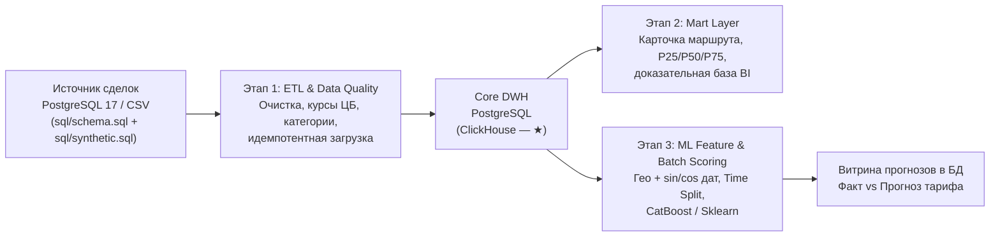

# Тестовое задание: Middle Data Engineer
## Платформа аналитики и прогнозирования тарифов грузоперевозок (Smart Logistics Data & ML Platform)

Привет! Я CTO **«Умной Логистики»** ([ul.su](https://ul.su)) — ведущей B2B SaaS-экосистемы для управления транспортной логистикой и цепочками поставок в РФ. Ежедневно через нашу платформу тысячи грузовладельцев, экспедиторов и транспортных компаний распределяют заказы, проводят тендеры и спот-аукционы, отслеживают рейсы и рассчитывают экономику перевозок.

Одна из ключевых бизнес-задач нашей платформы данных — дать логистам и закупщикам **инструмент принятия решений по транспортным ставкам**. Клиенту недостаточно увидеть абстрактную «среднюю цену»: чтобы обосновать бюджет тендера или быстро закрыть срочный спот-рейс, ему нужен **рыночный коридор ставок** (медиана и квартили в разрезе `руб./рейс` и `руб./км`), прозрачная **доказательная база** (число реальных закрытых рейсов и уникальных перевозчиков на маршруте) и **ML-прогноз справедливого тарифа** на будущий период.

Цель этого тестового задания — посмотреть, как ты проектируешь хранилища и аналитические витрины данных, выстраиваешь надежные идемпотентные ETL-пайплайны на приближенных к бою данных и подготавливаешь признаки для ML-моделей без утечек данных (*Data Leakage*).

### Формат и условия выполнения
* **Формат:** Самостоятельная оффлайн-разработка сквозного прототипа (*Take-Home Project*) из **3 связанных этапов**.
* **Таймбокс:** Ориентировочно **2–3 дня** (мы оцениваем архитектурную зрелость и чистоту инженерных решений, а не количество бойлерплейта).
* **Сдача результата:** Исходный код публикуется в публичном репозитории на **GitHub** или **GitLab**, ссылка передается HR-менеджеру.
* **Развертывание:** Весь проект (СУБД, генерация/инициализация данных, пайплайны и скоринг) обязан разворачиваться локально одной командой:
  ```bash
  docker-compose up
  ```

### Обязательная часть и задачи со звёздочкой

**Обязательная часть** проверяет базовые навыки инженера данных:

* **PostgreSQL 17** как основное хранилище;
* **SQL** для моделирования и расчёта аналитических витрин;
* **Python** для ETL, валидации и интеграции с БД;
* **базовый ML**: подготовка признаков, временное разбиение, обучение регрессионной модели и batch-скоринг.

**Задачи со звёздочкой (бонус):**

* реализация ETL в **Apache Airflow**;
* публикация результата в **Apache Superset**;
* реализация аналитического слоя в **ClickHouse** вместе с обязательным PostgreSQL или перенос части витрин в ClickHouse.

Бонусные технологии не обязательны и не влияют на оценку базового прохождения задания. Их использование должно сохранять те же результаты, что и обязательная реализация.



---

## Входные материалы и приложения пакета

Все необходимые схемы, генераторы и продуктовые материалы собраны в этой директории:
* [`sql/schema.sql`](sql/schema.sql) — эталонная DDL-схема операционной БД `deals_bigdata` (PostgreSQL 17).
* [`sql/synthetic.sql`](sql/synthetic.sql) — детерминированный генератор реалистичных тестовых данных со всеми краевыми случаями (300 000 сделок по умолчанию).
* [`attachments/ml-report.md`](attachments/ml-report.md) — референсный R&D-отчёт по исследованию ML-модели прогнозирования тарифов (признаки, защита от утечек, метрики и сравнение алгоритмов).
* [`attachments/data-requirements.md`](attachments/data-requirements.md) — бизнес-требования к аналитическому инструменту ставок.
* [`attachments/meeting-summary.md`](attachments/meeting-summary.md) — продуктовый контекст и пользовательские сценарии работы с коридором ставок и доказательной базой.
* [`attachments/bigdata-demo.html`](attachments/bigdata-demo.html) — интерактивный демо-прототип целевого дашборда (можно открыть локально в браузере для знакомства с продуктом).

---

## Функциональные требования (3 этапа сквозного проекта: ETL → DWH → ML)

Задание построено как единый конвейер данных поверх реальной предметной модели сервиса ставок `deals_bigdata`. Тебе предстоит реализовать три взаимосвязанных модуля.

---

### Вопрос 1. Пайплайн обработки и очистки данных (ETL на Python; Apache Airflow — задача со звёздочкой)

Возьми за основу схему операционной БД из [`sql/schema.sql`](sql/schema.sql) и сырые данные на базе [`sql/synthetic.sql`](sql/synthetic.sql) (либо CSV-выгрузку из них) и реализуй регулярный пакетный пайплайн извлечения, валидации, очистки и загрузки данных в базовый слой хранилища (**Core DWH**).

1. **Валидация и очистка данных (Data Quality & Cleansing):**
   * Отфильтруй невалидные и битые записи: нулевые или отрицательные цены (`price <= 0`), а для RUB также source-validation диапазон `price <= 1000`, некорректные дистанции (`distance <= 0`), отрицательный вес или объём (`total_weight < 0`, `total_volume < 0`) или отсутствие города в справочнике `cities`. Совпадение `loading_city_gcid = unloading_city_gcid` не является обязательным production-DQ-правилом: исходный job сохраняет такую пару и расстояние, поэтому отбраковывать её можно только как отдельно документированную бизнес-гипотезу. Отбракованные строки не должны теряться бесследно — логируй статистику отсева или сохраняй их в карантинную таблицу `dq_quarantine_prices` с кодом причины.
   * **Конвертация валют в RUB (`currency_code`):** в источнике встречаются ставки в рублях (`643`), долларах (`840`) и евро (`978`). Для иностранной валюты используй точный курс по `nearest_rate_date`; это поле в production заполняется относительно `created_at`, а не `loading_date`. Если точного курса нет, валютную строку исключи из нормализованной витрины или отправь в карантин — fallback по `loading_date` не требуется.
   * **Обогащение категорий и контроль выбросов:**
     * Заполни пропуски в `weight_category` (`G20T` при $\ge 30$ т, `FTL` при $[10; 30)$ т, `10T` при $[5; 10)$ т, `5T` при $[2.5; 5)$ т, `L5T` при $[0.5; 2.5)$ т, иначе `OTH` — по весу с округлением до `0.1` т) и `volume_category` (`FTL` при $0 < V \le 120\text{ м}^3$, иначе `OTH`).
     * Используй предоставленный в источнике `outlier_mark` как входной флаг: записи с `outlier_mark = true` исключаются из рыночной витрины, а сам флаг в базовом решении не пересчитывается. Обрати внимание на краевой случай в [`sql/synthetic.sql`](sql/synthetic.sql): самые свежие сделки за последний день снимка (`2026-10-26`) ещё не прошли ночной джоб разметки аномалий и имеют `outlier_mark = false` по умолчанию — это ограничение исходных данных нужно явно зафиксировать в README.
     * Дополнительный пересчёт выбросов допускается только как необязательное улучшение. Если его реализуешь по аналогии с `MarkOutlierPrices`, зафиксируй точную логику: только факты, группа `price_group_id` с минимум 4 строками, IQR по сырому `price`, P5–P95 по сырому `price_km`; это не обязательный DQ-шаг и не замена фильтру `outlier_mark`.

2. **Идемпотентность и поддержка Backfill:**
   * Пайплайн должен параметризоваться окном дат (`start_date` / `end_date` или `logical_date` в Airflow).
     * Повторный запуск задачи за уже загруженный период **обязан быть строго идемпотентным**: количество строк и суммы/перцентили в целевом хранилище и витринах не должны задваиваться (реализуй `UPSERT / ON CONFLICT` или атомарную перезапись партиции `DELETE + INSERT` в транзакции; дедупликация в ClickHouse — вариант для бонусной реализации).

---

### Вопрос 2. DWH, моделирование и аналитические витрины (PostgreSQL / SQL; ClickHouse — задача со звёздочкой)

Поверх очищенных данных Core DWH и справочников из [`sql/schema.sql`](sql/schema.sql) (`cities`, `body_types`, `price_body_types`, `price_dates`), опираясь на продуктовые требования [`attachments/data-requirements.md`](attachments/data-requirements.md) и [`attachments/meeting-summary.md`](attachments/meeting-summary.md), спроектируй аналитический слой витрин данных и настрой его регулярное обновление в конвейере.

1. **Проектирование слоя аналитических витрин (Mart Layer):**
   * Спроектируй физическую схему аналитического слоя в отдельной схеме `mart` / `dwh` с таблицами или материализованными представлениями в **PostgreSQL 17** для быстрой работы BI. Подключение результата в **Apache Superset** и реализация витрин на семействе движков `MergeTree` в **ClickHouse** — задачи со звёздочкой.
   * Устрани структурные аномалии измерений при расчёте витрин:
     * **Дедупликация городов (`cities`):** поле `gc_id` в источнике **не уникально** (у одного города может быть несколько строк с разными `id` и вариантами `full_name_local`). Прямой `JOIN` без дедупликации справочника размножит сделки и исказит статистику.
     * **Унификация групп кузова (`body_types` / `price_body_types`):** у одной сделки может быть указано несколько дочерних типов кузова из 1С (или `body_type IS NULL`). Приведи кузова к стандартизированным бизнес-группам по `std_id`:
       * `Тент` (`id IN (56, 57, 58, 59, 60, 61)` → `std_id = 56`);
       * `Рефрижератор` (`id IN (4, 46, 47, 48)` → `std_id = 4`);
       * `Изотерм` (`id = 2` → `std_id = 2`);
       * `Борт` (`id IN (1, 15)` → `std_id = 15`);
       * `Прочие` (остальные коды) и `Не указан` (`NULL`), не допуская дублирования одной цены внутри одной группы кузова.

2. **SQL-витрина «Карточка маршрута и коридор рыночных ставок»:**
   * Напиши производительный SQL-запрос (и оформи его как витрину `mart_route_card` / `mart_market_corridor`) в разрезе: **`месяц` × `город отправления` × `город назначения` × `группа кузова` × `весовая категория`**. Месяц формируй из `price_dates.price_date`; `volume_category` можно сохранить как атрибут, но не добавляй его в grain без явного обоснования.
   * **Правила фильтрации выборки:**
     * Учитываются только фактические завершённые перевозки (`is_fact = true`, то есть `price_type IN (1, 2, 3, 4, 5, 9)`), простые прямые маршруты (`complex = false`), валидные значения цены и дистанции (`price > 0`, `distance > 0`) и строки с успешно рассчитанным `price_rub`.
     * Исключаются статистические выбросы по флагу `outlier_mark = true`.
     * Плановые месяцы из будущего (`price_dates.price_date > '2026-10-26'`) не должны попадать в историческую статистику рынка. Для ML отдельное правило будущего скоринга задаётся по `loading_date`.
   * **Рассчитываемые метрики карточки маршрута (в RUB без НДС):**
     * **Рыночный коридор за рейс (`руб./рейс`):** 25-й перцентиль (`p25_trip`), 50-й перцентиль / медиана (`median_trip`), 75-й перцентиль (`p75_trip`), среднее значение (`avg_trip`);
     * **Рыночный коридор за километр (`руб./км`):** 25-й перцентиль (`p25_km`), медиана (`median_km`), 75-й перцентиль (`p75_km`) от величины `price_rub / NULLIF(distance, 0)`;
     * **Доказательная база и надёжность (Data Trust):**
       * `trips_count` — число уникальных сделок в ячейке;
       * `carriers_count` — число уникальных перевозчиков (`COUNT(DISTINCT organization_id)` при `price_type IN (3, 9)`);
       * `cv_rate` — `stddev_samp(price_rub) / avg(price_rub)`; при менее чем двух наблюдениях или нулевом среднем возвращай `NULL`;
       * `mom_pct` / `yoy_pct` — относительное изменение `P50` к календарному предыдущему месяцу и к тому же месяцу прошлого года (в %); если соответствующей ячейки нет или знаменатель равен нулю, возвращай `NULL`, не подставляй «последний доступный» месяц;
       * `reliability_level` — `HIGH`, если `trips_count >= 30`, `carriers_count >= 5` и свежесть последнего месяца не более 30 дней относительно `as_of`; `MEDIUM`, если `trips_count >= 10`; иначе `LOW_DATA`.

---

### Вопрос 3. ML Feature Engineering & Batch Inference тарифов

Опираясь на выводы исследования [`attachments/ml-report.md`](attachments/ml-report.md), на базе очищенных данных построй воспроизводимый ML-пайплайн прогнозирования фактической ставки перевозчика за рейс в рублях без НДС (`target = price_rub`) и организуй пакетный скоринг (*Batch Inference*) сделок с записью результата в БД.

1. **Feature Pipeline (подготовка и инженерия признаков):**
   * **Географические и маршрутные признаки:** обогати сделки из дедуплицированного справочника `cities` (минимальный `cities.id` на `gc_id`) — извлеки **регион отправления** и **регион назначения** из полного наименования населённого пункта (`full_name_local`, например: `'Казань, Республика Татарстан'` → город `'Казань'`, регион `'Республика Татарстан'`), а также геокоординаты (`latitude`, `longitude`). Кодируй отправление и назначение раздельно (регионы несут более плотный сигнал на редких направлениях, чем склеенная строка маршрута высокой кардинальности).
   * **Параметры груза и транспорта:** плановое расстояние (`distance`), тоннаж (`total_weight`), объём (`total_volume`), стандартизированная группа/тип кузова (`body_group` / `body_type`), весовая и объёмная категории.
   * **Периодическое кодирование дат (Cyclical Time Encoding):** рынок грузоперевозок имеет выраженную сезонность (предпраздничный пик в декабре, летний сезон) и годовой инфляционный тренд. Извлеки из `loading_date` год, месяц, день недели и день года, а для циклических компонент рассчитай гармонические признаки:
     $$\sin\left(\frac{2\pi \cdot t}{T}\right), \quad \cos\left(\frac{2\pi \cdot t}{T}\right)$$
     (например, для дня года $T = 365.25$, для месяца $T = 12$, для дня недели $T = 7$).
   * **Предотвращение утечки данных (Data Leakage Prevention — критично!):**
     * Исключи из признакового пространства любые прямые и косвенные производные целевого тарифа: ставку с НДС (`price_with_vat`), удельные тарифы текущего рейса (`price / distance`, `price / total_weight`), расчётные показатели маржи/прибыли заказчика и экспедитора ($\text{carrier\_cost} = \text{customer\_cost} - \text{profit}$), а также предрассчитанные групповые агрегаты текущего месяца из `price_group_stats` (`avg_price`, `min_km_price`, `max_km_price`, `price_group_id`), в расчёт которых уже вошла предсказываемая сделка!
     * В базовой реализации очищай таргет по предоставленному `outlier_mark`; не используй этот флаг как признак модели. `price_group_stats` также запрещён как признак: production-команда строит его по сырой цене и агрегат может включать текущую предсказываемую сделку. Любая дополнительная очистка по доверительному интервалу $\ln(\text{price\_rub})$ / IQR и обучение трансформеров (`SimpleImputer`, `StandardScaler`, `TargetEncoder`) должны выполняться **строго на `train`-выборке**.

2. **Валидация, обучение бейзлайн-модели и Batch Prediction:**
   * Раздели исторические фактические сделки (`is_fact = true`, `complex = false`) **строго хронологически (Time-Based Split)** по дате погрузки. В задании `now` — это дата снимка `as_of = 2026-10-26`, а не системная дата запуска:
     * `train`: `[as_of - 3 месяца, as_of - 3 недели)` = **`2026-07-26` включительно — `2026-10-05` не включительно**;
     * `test`: `[as_of - 3 недели, as_of]` = **`2026-10-05` — `2026-10-26` включительно**.
     Граница `2026-10-05` входит только в `test`. Случайный `shuffle=True` на временных данных недопустим.
   * Обучи модель градиентного бустинга (**`CatBoostRegressor`** — рекомендуемый выбор для табличных данных с категориями) и, по желанию, сравни её с линейным или деревянным бейзлайном (`Ridge` / `DecisionTreeRegressor` из `scikit-learn`).
   * Рассчитай и выведи в лог / отчёт метрики качества на `test`-выборке: **$R^2$**, **MAPE (%)**, **RMSE (руб.)** и **MAE (руб.)**.
   * Выполни **пакетный скоринг (Batch Inference)** для отложенного тестового периода и плановых будущих заявок (`loading_date > '2026-10-26'`, присутствующих в датасете) и сохрани прогнозы в таблицу БД (например, `mart.ml_price_predictions`: `price_id`, `loading_date`, `loading_city_gcid`, `unloading_city_gcid`, `body_group`, `actual_price_rub`, `predicted_price_rub`, `abs_error_rub`, `ape_pct`, `model_name`, `scored_at`) для аналитического сравнения **Факт vs Прогноз**. Для будущих заявок `actual_price_rub`, `abs_error_rub` и `ape_pct` должны быть `NULL`, даже если в исходной строке заполнено поле `price`.

---

## Нефункциональные требования (Архитектура и качество)

* **Идемпотентность и надежность пайплайнов:**
  * Любой шаг (инициализация схемы, ETL-загрузка батча, пересчёт витрин, пакетный ML-скоринг) должен безопасно переживать повторный запуск за тот же интервал дат без дублей и нарушения целостности данных.
  * Пакетные операции с БД выполняются батчами (`execute_values` / `COPY` / векторизованная вставка / SQL-трансформации `ELT`), **без построчных `INSERT` в Python-цикле** на сотнях тысяч записей.
* **Методологическая чистота ML:**
  * Строгая защита от *Target Leakage* и *Temporal Leakage* (никакого заглядывания в будущее при расчёте статистик и валидации).
  * Полная воспроизводимость: фиксация `random_seed` во всех генераторах и моделях, детерминированные границы `train / test`.
* **Качество инженерного кода и структура репозитория:**
  * Чёткое разделение слоёв проекта (`sql/` или `migrations/`, обязательный `etl/`, `ml/`, `tests/`, `docker/`; `dags/` — для бонусной реализации Airflow).
  * Конфигурация подключений и параметров — через переменные окружения (`.env.example`), без захардкоженных паролей и абсолютных путей локальной машины.
  * Структурированное логирование ключевых этапов (сколько строк прочитано, сколько ушло в карантин DQ, сколько обновлено в витрине, какие метрики показала модель).
  * Наличие базовых автотестов (`pytest` или SQL smoke-проверок) на правила очистки данных, отсутствие дублей при повторном прогоне и корректность признаков будет весомым плюсом.

---

## Технологический стек: обязательная часть и бонус

Для базового решения используй:

* **PostgreSQL 17** — основное хранилище, слои `raw` → `core` → `mart`;
* **SQL** — DDL, трансформации, агрегации и аналитические витрины;
* **Python 3.11+** (`pandas` / `polars`, `numpy`, `SQLAlchemy` / `psycopg`);
* **базовый ML** — `Scikit-learn` и/или `CatBoost` для регрессии, временной валидации и batch-скоринга.

Задачи со звёздочкой:

* **Apache Airflow** — регулярный DAG вместо запуска Python-пайплайна вручную;
* **Apache Superset** — подключение витрин и демонстрационный дашборд;
* **ClickHouse** — перенос аналитического слоя или части витрин на `MergeTree` / `ReplacingMergeTree`.

Дополнительные инструменты (`dbt`, `Pandera`, `Pydantic`, `Great Expectations`) остаются необязательными улучшениями и не заменяют обязательную реализацию.

---

## Схема входных данных и тестовый датасет

В качестве источника используются файлы из каталога [`sql/`](sql/):
* **DDL-схема БД:** [`sql/schema.sql`](sql/schema.sql)
* **Детерминированный генератор данных:** [`sql/synthetic.sql`](sql/synthetic.sql) (по умолчанию генерирует **300 000** сделок с фиксированным зерном `SELECT setseed(0.20261026)`, дата снимка — **`2026-10-26`**).

Быстрая инициализация источника в контейнере `postgres:17`:
```bash
psql -U postgres -d deals_bigdata -v ON_ERROR_STOP=1 -f sql/schema.sql
psql -U postgres -d deals_bigdata -v ON_ERROR_STOP=1 -v n_prices=300000 -f sql/synthetic.sql
```

### Ключевые таблицы источника
| Таблица | Назначение и доменные особенности |
| :--- | :--- |
| **`prices`** | Факты сделок и ставок. Содержит дату погрузки `loading_date`, коды городов `loading_city_gcid` / `unloading_city_gcid`, плечо `distance` (км), тоннаж `total_weight` (т), объём `total_volume` ($\text{м}^3$), тип кузова `body_type`, ставку `price` (за рейс без НДС), код валюты `currency_code` (`643` RUB, `840` USD, `978` EUR), тип записи `price_type` (`1, 2, 3, 4, 5, 9` — факт `is_fact = true`; `6` — ставки торгов `is_fact = false`), флаг составного маршрута `complex`, дату курса `nearest_rate_date`, флаг выброса `outlier_mark`. |
| **`cities`** | Справочник населённых пунктов (`gc_id`, `name`, `full_name_local` формата *«Город, Регион»*, координаты `latitude`, `longitude`). **Внимание:** `gc_id` не уникален (есть дубли для Москвы `1001` и Казани `1003`). |
| **`body_types`** и **`price_body_types`** | Справочник типов кузовов из 1С с маппингом в родительский стандарт `std_id` и таблица связи многие-ко-многим `price_id × body_type_id` (у 12% сделок указано 2 совместимых типа кузова, у ~2% строк кузов не заполнен). |
| **`exchange_rates`** | Курсы валют ЦБ РФ (`num_code`, `value`, `setting_date`). Публикуются со вторника по субботу; для `643` курс равен `1.0`. |
| **`price_dates`** | Помесячная развертка долгосрочных заявок от `loading_date` до `end_loading_date`. |
| **`price_group_stats`** | Служебная статистика ночного джоба по группам маршрутов (`avg_price`, `min_km_price`, `max_km_price`). **Осторожно в Вопросе 3:** содержит агрегаты по целевой переменной! |

### Справочник ролей `price_type`
| `price_type` | Тип записи | Роль организации (`organization_id`) | `is_fact` |
| :---: | :--- | :--- | :---: |
| `1` | Заявка заказчика | Грузовладелец | `true` |
| `2` | Заявка экспедитора | Экспедитор | `true` |
| `3` | Заявка перевозчика | Перевозчик | `true` |
| `4`, `5` | Исторические закрытые заявки | — | `true` |
| `6` | Ставки торгов / аукционов | Перевозчик (участник торгов) | `false` |
| `9` | Прямой заказ | Перевозчик | `true` |

### Примеры строк тестового датасета (с краевыми случаями)

**Справочник `cities` (пример дублирования `gc_id` и формата региона):**
| id | gc_id | name | full_name_local | latitude | longitude | Комментарий |
| :---: | :---: | :--- | :--- | :---: | :---: | :--- |
| 1 | 1001 | Москва | Москва, г. Москва | 55.7558 | 37.6173 | Основная запись |
| 3 | 1003 | Казань | Казань, Республика Татарстан | 55.7961 | 49.1064 | Основная запись (регион после запятой) |
| 4 | 1004 | Екатеринбург | Екатеринбург, Свердловская обл. | 56.8389 | 60.6057 | Основная запись |
| 42 | 1003 | Казань | Казань г, Татарстан | 55.7961 | 49.1064 | Дубль `gc_id = 1003` с другим написанием |

**Таблица сделок `prices` (типичные записи и заложенные аномалии):**
| id | loading_date | loading_city_gcid | unloading_city_gcid | distance | total_weight | body_type | price | currency_code | price_type | is_fact | nearest_rate_date | outlier_mark | Кейс в данных |
| :---: | :---: | :---: | :---: | :---: | :---: | :---: | :---: | :---: | :---: | :---: | :---: | :---: | :--- |
| 1042 | 2026-09-15 | 1001 | 1003 | 897.0 | 20.0 | 56 | 84500.00 | 643 | 3 | `true` | 2026-09-12 | `false` | Валидный FTL-рейс (Тент, RUB) |
| 2089 | 2026-10-12 | 1002 | 1004 | 2235.0 | 18.5 | 4 | 2480.00 | 840 | 1 | `true` | `NULL` | `false` | Валюта USD без `nearest_rate_date` — проверить курс и отправить в карантин при его отсутствии |
| 3115 | 2026-08-20 | 1001 | 1003 | 897.0 | 20.0 | 56 | 345000.00 | 643 | 2 | `true` | 2026-08-20 | `true` | Размеченный ценовой выброс ($\times 4$) |
| 4501 | 2026-10-05 | 1006 | 1007 | 685.0 | 12.0 | 15 | 0.00 | 643 | 3 | `true` | 2026-10-03 | `false` | Невалидная нулевая ставка (`price = 0`) |
| 299850 | 2026-11-10 | 1001 | 1004 | 1782.0 | 21.5 | 56 | 152000.00 | 643 | 1 | `true` | 2026-10-24 | `false` | Плановая погрузка после `2026-10-26` (скоринг) |

---

## Инструкция по сдаче результата

1. Опубликуй готовое решение в публичном репозитории на **GitHub** или **GitLab** и отправь ссылку HR-менеджеру.
2. Убедись, что на чистой машине с установленным Docker проект поднимается без ручных правок командой `docker-compose up`.
3. Проверь наличие в репозитории обязательных артефактов по чек-листу:
   * [ ] `README.md` — архитектура решения, обоснование выбранного стека (СУБД, оркестратор, ML-модель), пошаговая инструкция запуска, примеры SQL-запросов для проверки витрин и сводка полученных метрик ML ($R^2$, MAPE, RMSE, MAE);
   * [ ] `docker-compose.yml`, `Dockerfile`(ы) и `.env.example` — инфраструктура и переменные окружения;
   * [ ] `etl/` — обязательный код пайплайна валидации, очистки, конвертации валют и идемпотентной загрузки данных с инструкцией повторного запуска за выбранный период (Вопрос 1);
   * [ ] `dags/` — необязательный артефакт для бонусной реализации на Apache Airflow;
   * [ ] `sql/` (или `migrations/`) — DDL аналитического слоя (Core / Mart) и эталонный SQL-запрос расчета карточки маршрута и рыночного коридора (Вопрос 2);
   * [ ] `ml/` — код Feature Pipeline, хронологического обучения модели и пакетного скоринга (Batch Inference) с сохранением прогнозов в БД (Вопрос 3).

---

*Удачи! В «Умной Логистике» мы ценим инженерную культуру, внимание к качеству данных и умение видеть реальный бизнес-смысл за таблицами и метриками. Ждем твое решение!*
